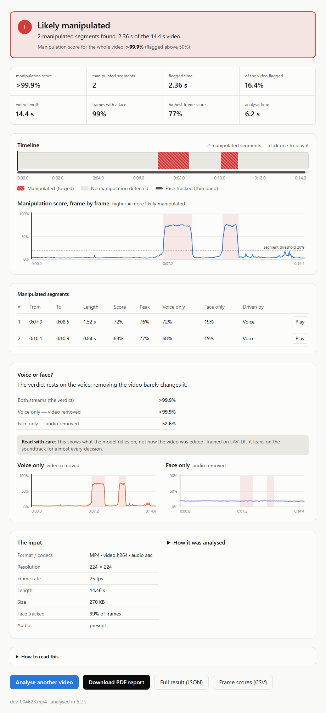

# Audio-Visual Temporal Forgery Detection & Localization

[](https://github.com/dineshkumarpmb/Audio-Visual-Temporal-Forgery-Detection---Localization/actions/workflows/ci.yml)


Detects whether a talking-head video has been manipulated — and **where**. Given a video, it
returns a verdict, the forged time segments in seconds, a score for every 40 ms frame, and a
report you can download as a PDF. Audio and video are treated as two views of one event and fused
with cross-modal attention and a Transformer, on a 4 GB laptop GPU.

It is a from-scratch rebuild of a final-year project whose source code was lost. Every number in
this README is measured and traced to the JSON an experiment wrote; `make check-docs` recomputes
them, and CI fails if one drifts.



> **Demo capture:** pending (task P14-11). The screenshot is the real result page on a real model
> output, rendered without the video.

---

## Contents

1. [Why localization](#why-localization)
2. [Features](#features)
3. [Results at a glance](#results-at-a-glance)
4. [How it works](#how-it-works)
5. [Requirements](#requirements)
6. [Installation](#installation)
7. [Running the app](#running-the-app)
8. [Using the web app](#using-the-web-app)
9. [Configuration](#configuration)
10. [API reference](#api-reference)
11. [The dataset](#the-dataset)
12. [Reproducing the results](#reproducing-the-results)
13. [Results in detail](#results-in-detail)
14. [Limitations](#limitations)
15. [Testing and CI](#testing-and-ci)
16. [Project structure](#project-structure)
17. [Make targets](#make-targets)
18. [Troubleshooting](#troubleshooting)
19. [FAQ](#faq)
20. [Documents](#documents)
21. [License and citation](#license-and-citation)

---

## Why localization

Modern audio-visual forgeries rarely replace a whole video. They change a word or two — *"I do not
support this"* becomes *"I do support this"* — by regenerating a second or two of lip motion and
matching synthetic speech. The rest of the clip is genuine.

That breaks whole-video classifiers twice over: a one-second forgery in a fifteen-second clip is
diluted into the noise, and a bare "fake" verdict tells a journalist or a moderator nothing they can
act on. This system answers the question that matters: **which seconds were altered.**

## Features

- **Detection and localization in one pass** — a clip verdict, forged segments `(start, end,
  confidence)` in seconds, per-frame scores, and segment-boundary estimates.
- **Explains itself honestly** — the same model re-run with the video removed and with the audio
  removed shows which stream drove each flagged span, with the caveat that this describes the
  model, not the edit.
- **Web app** — drag-and-drop upload with progress, a clickable timeline of forged spans, a
  synchronised video player, keyframe thumbnails around each span, and plain-language errors.
- **Downloadable report** — a 3-page vector PDF, plus the full result as JSON and per-frame scores
  as CSV.
- **REST API** — FastAPI with streamed uploads (never held in memory), verified inputs, a bounded
  job queue running one analysis at a time, structured errors, and OpenAPI docs.
- **Runs on a laptop** — 4.45<!--n:reports/benchmark.json#variants/optimized/s_per_10s/median|2--> s per 10 s clip on a GTX 1650 with 4 GB
  of VRAM; the model file is 31.1<!--n:reports/model_export.json#size_mb|1--> MB.
- **Measured, not assumed** — 3 seeds per configuration, a 13-claim ablation with its failures
  reported, a test split scored exactly once, and documentation checked against the results.

## Results at a glance

LAV-DF, dev-2k subset: trained on **592**<!--n:reports/experiment_f.json#arms/F0/n_clips_train|int--> clips, tuned on
175<!--n:reports/evidence_table.json#n_dev_clips|int--> dev clips, scored **once** on 392<!--n:reports/test_once.json#n_clips|int--> held-out test clips.
Mean of 3 seeds.

| | test |
|---|---|
| clip ROC-AUC | **0.984**<!--n:reports/test_once.json#summary/auc/mean|3--> |
| clip F1 | 0.967<!--n:reports/test_once.json#summary/f1/mean|3--> |
| **forged-segment AP@0.5** | **0.801**<!--n:reports/test_once.json#summary/ap@0.5/mean|3--> |
| segment AP@0.75 | 0.539<!--n:reports/test_once.json#summary/ap@0.75/mean|3--> |
| mean boundary error | 97<!--n:reports/test_once.json#summary/boundary_error_ms/mean|int--> ms |
| real videos given a false segment | 2.6<!--n:reports/test_once.json#summary/fp_video_rate/mean|pct1-->% |
| end to end, raw video → segments | 4.45<!--n:reports/benchmark.json#variants/optimized/s_per_10s/median|2--> s per 10 s clip |

> ⚠️ **Read [Limitations](#limitations) before quoting these.** The model reads the soundtrack and
> ignores the face, part of what it reads is a dataset artefact, and everything was measured on one
> dataset at subset scale.

## How it works



The design has **two stages**, because 6 GB of system RAM — not 4 GB of VRAM — is the binding
constraint. Decoding video inside a training loop exhausts it, so features are extracted once and
cached.

**Stage A — features, once per video.**

| step | what | detail |
|---|---|---|
| face tracking | MediaPipe FaceLandmarker (CPU) | every 5th frame, tracked between; 5 alignment points |
| alignment | similarity transform | 112×112 face crop per frame |
| visual features | MobileNetV2, frozen, ImageNet weights | one 1280-d vector per frame (decision D-1) |
| audio | ffmpeg → 16 kHz mono | any input codec |
| audio features | log-Mel, 80 bins, hop 640 samples | **40 ms = exactly one video frame at 25 fps** (decision C-1) |

Because one audio frame is exactly one video frame, the two streams align by array index — never by
interpolation.

**Stage B — the trained model** (5.85<!--n:reports/model_export.json#params_stage_b|mega2--> M parameters):

1. a linear projection of the visual features and a dilated 1D-CNN over the audio, both to 256-d;
2. **bidirectional cross-attention**, 2 layers — video attends to audio and audio to video;
3. a **Transformer encoder**, 4 layers, 4 heads, learned positions up to 750 frames (longer clips
   are processed in overlapping chunks and stitched);
4. three heads: an attention-pooled **clip verdict**, a **per-frame score** (focal loss), and a
   **start/end boundary** heatmap.

Training adds an InfoNCE audio-visual sync loss, auxiliary single-stream heads and modality dropout
(p = 0.2), all aimed at stopping the model collapsing onto one stream — which, measured, none of them
prevented (see [Limitations](#limitations)).

**Post-processing** turns frame scores into segments with a configuration tuned on dev and then
frozen (`configs/postprocess_frozen.json`): median filter over 5 frames → threshold 0.2 →
morphological closing (3) → drop spans under 0.2 s.

## Requirements

| | version | why |
|---|---|---|
| Python | **3.10** exactly | mediapipe wheel coverage; the LAV-DF reference toolchain pins `<3.11` |
| ffmpeg | any recent, on PATH | audio decoding (MP4 / MOV / AVI / MKV) |
| Node.js | 22 | the web app (Vite) |
| NVIDIA GPU | optional | 4 GB is enough; CPU works, several times slower |
| RAM | 6 GB minimum | the API holds the model (1–3 GB working set); close heavy apps |
| disk | ~5 GB for the subset | features and caches; the raw dataset is never downloaded |

CUDA builds of PyTorch need driver support: this project pins **torch 2.7.1 + CUDA 11.8**
(driver ≥ 522.06). CI runs on Linux with the CPU build.

## Installation

```bash
git clone https://github.com/dineshkumarpmb/Audio-Visual-Temporal-Forgery-Detection---Localization.git
cd Audio-Visual-Temporal-Forgery-Detection---Localization

make venv              # .venv with Python 3.10
make torch             # PyTorch 2.7.1 from the CUDA 11.8 index
make install-dev       # the project + dev tools + pre-commit hooks
make check             # environment gate -- exits non-zero if anything is missing
make models            # MediaPipe face-landmarker weights (hash-pinned)
make frontend-install  # the web app's dependencies (npm ci)
```

> ⚠️ **Never `pip install torch` from PyPI.** On Windows PyPI serves CPU-only wheels, and a later
> install could silently replace a working CUDA build. Torch is deliberately left out of
> `pyproject.toml`'s dependencies; `make torch` installs it from the right index.

**Without `make`** (any OS):

```bash
python3.10 -m venv .venv
.venv/bin/pip install torch==2.7.1 torchvision==0.22.1 torchaudio==2.7.1 --index-url https://download.pytorch.org/whl/cu118
.venv/bin/pip install -e ".[dev]"
.venv/bin/python scripts/08_fetch_models.py
cd frontend && npm ci && cd ..
```

On Windows use `.venv\Scripts\` instead of `.venv/bin/`.

**The trained weights are not in this repository** (`models/avtfd_g_seed0.pt`, 31 MB, derived from
non-commercial data). Produce them with [Reproducing the results](#reproducing-the-results), whose
last stage runs `make export-model`, or copy an existing file to that path.

## Running the app

```bash
make demo
```

This checks the model file, the web app's install and that both ports are free; starts the API on
`:8000` and waits for the model to load (about 25 s); starts the web app on `:5173`; and opens your
browser. **Ctrl+C stops both.** `make demo-check` runs only the checks.

To run the two halves separately, in two terminals:

```bash
make api        # http://127.0.0.1:8000  (interactive API docs at /docs)
make frontend   # http://127.0.0.1:5173  (proxies /api to :8000)
```

Restart `make api` after pulling new code: the web app hot-reloads, the API does not, and a new page
talking to an old API is the most common source of confusing errors.

## Using the web app

1. **Upload** — drop a video on the page or choose a file: MP4, MOV, AVI or MKV, up to 200 MB,
   0.5 s to 5 minutes, **with sound** and a visible speaking face.
2. **Wait** — the page shows your place in the queue, then the analysis (about 5 s for a 10 s clip).
3. **Read the result:**

| section | what it tells you |
|---|---|
| verdict | *Likely manipulated* or *No manipulation detected*, a one-sentence summary, the whole-video score |
| key figures | score, number of segments, flagged seconds and share, length, face coverage, peak score, analysis time |
| timeline | the whole video; red hatched blocks are forged spans — click one to play it; the thin band marks frames with a tracked face |
| score chart | how likely each 40 ms frame is to be manipulated; hover for values, click to seek |
| keyframes | the face before, at the start, middle and end of, and after each span |
| segments | exact times, score, peak, the score with each stream alone, and which stream drove it |
| voice or face? | the model re-run with one stream removed, with the caveat that this is the model's reliance, not the edit |
| input & details | format, codecs, resolution, timings, model and thresholds |

4. **Download** — the **PDF report** (3 pages: verdict and timeline; evidence, segments and
   keyframes; input, method and limitations), the full **JSON** result, or **CSV** frame scores.

Results and thumbnails are kept in memory for one hour, then forgotten. Nothing is written to disk
except the upload, which is deleted as soon as it has been analysed.

## Configuration

The API reads `AVTFD_*` environment variables, or a `.env` file in the repository root (copy
`.env.example`).

| variable | default | meaning |
|---|---|---|
| `AVTFD_MODEL_PATH` | `models/avtfd_g_seed0.pt` | the model bundle to serve |
| `AVTFD_DEVICE` | `auto` | `auto` \| `cuda` \| `cpu` |
| `AVTFD_MAX_UPLOAD_MB` | `200` | upload cap, enforced while streaming |
| `AVTFD_MIN_DURATION_S` / `AVTFD_MAX_DURATION_S` | `0.5` / `300` | accepted video length |
| `AVTFD_JOB_TIMEOUT_S` | `300` | an analysis running longer is stopped and fails with `timeout` |
| `AVTFD_MAX_QUEUED_JOBS` | `4` | jobs allowed to wait; the next upload gets `503 queue_full` |
| `AVTFD_MAX_CONCURRENT_JOBS` | `1` | fixed at 1 — validated; 6 GB of RAM holds one analysis |
| `AVTFD_REQUIRE_FACE` | `true` | `false` scores clips with no detectable face from audio alone |
| `AVTFD_JOB_TTL_S` | `3600` | how long finished results are kept |
| `AVTFD_MAX_JOBS_KEPT` | `200` | cap on remembered jobs |
| `AVTFD_UPLOAD_DIR` | `data/interim/api_uploads` | where uploads stream to (cleared at startup) |
| `AVTFD_WARMUP` | `true` | pay the one-off GPU/JIT start-up cost at boot rather than on the first upload |

The API's **host and port** are set on the `uvicorn` command line (`make api` uses
`127.0.0.1:8000`). `AVTFD_API_HOST` / `AVTFD_API_PORT` in `.env.example` are not read by the server.
The web app's dev server proxies to `AVTFD_API_URL` (default `http://127.0.0.1:8000`).

Training and preprocessing settings are pydantic configs under `configs/` and `src/config.py`;
every cached feature directory is named by a hash of the config that produced it, so changing a
setting never silently reuses stale features.

## API reference

Base URL `http://127.0.0.1:8000`. Interactive documentation: **`/docs`** (Swagger UI) and
`/openapi.json`.

| method | path | purpose |
|---|---|---|
| `POST` | `/api/v1/analyze` | upload a video (multipart field `file`); returns a job id |
| `GET` | `/api/v1/jobs/{id}` | job status; the result or a structured error once finished |
| `GET` | `/api/v1/jobs/{id}/report.pdf` | the finished analysis as a PDF report |
| `GET` | `/api/v1/jobs/{id}/keyframes/{k}.jpg` | one keyframe thumbnail |
| `GET` | `/api/v1/model-info` | which model is serving, its thresholds, and every limit |
| `GET` | `/health` | liveness and queue state |

### Analyse a video

```bash
curl -F "file=@clip.mp4" http://127.0.0.1:8000/api/v1/analyze
```

```json
{"job_id": "769f4e1f781141169325501471c532c5", "status": "queued",
 "status_url": "/api/v1/jobs/769f4e1f781141169325501471c532c5", "queue_position": 0}
```

Poll the `status_url` (the web app polls every second) until `status` is `succeeded` or `failed`:

```bash
curl http://127.0.0.1:8000/api/v1/jobs/769f4e1f781141169325501471c532c5
curl -o report.pdf http://127.0.0.1:8000/api/v1/jobs/769f4e1f781141169325501471c532c5/report.pdf
```

A finished job (real output for a LAV-DF dev clip, arrays shortened):

```json
{
  "job_id": "769f4e1f781141169325501471c532c5",
  "status": "succeeded",
  "filename": "dev_004623.mp4",
  "media": {"container": "mov,mp4,m4a,3gp,3g2,mj2", "video_codec": "h264", "audio_codec": "aac",
            "width": 224, "height": 224, "fps": 25.0, "duration_s": 14.464, "size_bytes": 276276},
  "result": {
    "verdict": "fake", "is_fake": true, "clip_score": 0.999927, "threshold": 0.5,
    "n_frames": 360, "duration_s": 14.4, "fps": 25.0,
    "segments": [{"start_s": 6.96, "end_s": 8.48, "confidence": 0.7187},
                 {"start_s": 10.08, "end_s": 10.92, "confidence": 0.6842}],
    "frame_scores": [0.043, 0.0363, "… one per frame"],
    "audio_only_scores": ["…"], "visual_only_scores": ["…"],
    "boundary_start_scores": ["…"], "boundary_end_scores": ["…"],
    "attention": ["…"], "face_found": [1, 1, "…"],
    "audio_only_clip": 0.999932, "visual_only_clip": 0.526051,
    "face_found_fraction": 0.9889, "audio_silent": false, "warnings": [],
    "evidence": {
      "summary": "2 manipulated segments found, 2.36 s of the 14.4 s video.",
      "frame_threshold": 0.2,
      "key_figures": {"n_segments": 2, "forged_s": 2.36, "…": "…"},
      "segments": [{"index": 0, "start_s": 6.96, "end_s": 8.48, "peak_score": 0.7623,
                    "audio_only_mean": 0.7189, "visual_only_mean": 0.1893,
                    "driver": "voice", "…": "…"}],
      "modality": {"reading": "The verdict rests on the voice: removing the video barely changes it.",
                   "caveat": "This shows what the model relies on, not how the video was edited. …"}
    },
    "keyframes": [{"frame": 162, "time_s": 6.48, "role": "before", "segment": 0, "face_found": true,
                   "url": "/api/v1/jobs/769f4e1f781141169325501471c532c5/keyframes/0.jpg"}],
    "timings_s": {"detect": 5.2745, "visual": 0.4802, "model": 0.0482, "total": 6.1679, "…": "…"}
  },
  "error": null
}
```

Segments are always sorted, non-overlapping and inside `[0, duration]`. Frame *i* covers
`[i/25, (i+1)/25)` seconds.

### Errors

Every error — at upload or in a failed job — has the same shape and never contains a stack trace:

```json
{"error": {"code": "no_audio", "message": "the file has no audio track; ...", "detail": null}}
```

| HTTP | code | when |
|---|---|---|
| 400 | `malformed_upload` | the multipart body could not be parsed |
| 404 | `job_not_found` | unknown or expired job id (results expire after an hour) |
| 404 | `keyframe_not_found` | no keyframe with that index |
| 404 | `not_found` | no such route — usually a server older than the client |
| 405 | `method_not_allowed` | wrong HTTP method |
| 409 | `job_not_ready` | a report was requested before the job finished |
| 413 | `file_too_large` | over the upload cap (refused before or while reading) |
| 415 | `unsupported_format` | extension not MP4 / MOV / AVI / MKV |
| 415 | `unsupported_media_type` | not multipart, or a non-video content type |
| 415 | `format_mismatch` | the file's contents do not match its extension |
| 415 | `unsupported_codec` | an unusual video codec |
| 422 | `missing_file` · `empty_file` | no `file` field, or an empty one |
| 422 | `corrupt_video` | cannot be opened, or no frame decodes |
| 422 | `no_video_stream` | audio-only file |
| 422 | `no_audio` | no soundtrack — the model needs it |
| 422 | `duration_out_of_range` | shorter than 0.5 s or longer than 5 minutes |
| 422 | `invalid_request` | request failed validation |
| 503 | `queue_full` | too many jobs waiting; retry after the `Retry-After` seconds |
| — | `no_face` | job failed: no face in any frame (see `AVTFD_REQUIRE_FACE`) |
| — | `timeout` | job failed: the analysis exceeded `AVTFD_JOB_TIMEOUT_S` |
| — | `internal_error` | job failed unexpectedly; details are in the server log only |

## The dataset

**LAV-DF** (Localized Audio Visual DeepFake), built on VoxCeleb2: in each fake, a word or two of real
speech has its face, its voice or both replaced, and the forged periods are labelled in seconds.

| | |
|---|---|
| clips | 136,304<!--n:reports/dataset_facts.json#n_total|int--> — train 78,703<!--n:reports/dataset_facts.json#split_counts/train|int-->, dev 31,501<!--n:reports/dataset_facts.json#split_counts/dev|int-->, test 26,100<!--n:reports/dataset_facts.json#split_counts/test|int--> |
| classes | real 36,431<!--n:reports/dataset_facts.json#class_counts/real|int--> · face only 33,543<!--n:reports/dataset_facts.json#class_counts/visual_only|int--> · voice only 33,170<!--n:reports/dataset_facts.json#class_counts/audio_only|int--> · both 33,160<!--n:reports/dataset_facts.json#class_counts/both|int--> |
| total length | 320.9<!--n:reports/dataset_facts.json#total_hours|1--> hours, all at 25 fps / 16 kHz |
| licence | CC BY-NC 4.0 — non-commercial research; **not redistributed here** |

This project used the **dev-2k subset** (committed id lists in `data/manifests/subsets/`), read from a
public Kaggle mirror that was verified byte-equivalent to the authors' release. The official splits
are identity-disjoint, and the build fails if any speaker appears in two splits. Statistics:
[`reports/dataset_statistics.md`](reports/dataset_statistics.md).

## Reproducing the results

You need a Kaggle account and API token (`make check-kaggle` verifies it); videos are fetched clip by
clip from the mirror, never as the full 25.6 GB.

```bash
make phase1     # metadata → manifest (leakage checks are fatal) → subsets → statistics
make phase2     # face tracking and alignment; labels verified against the media
make phase3     # log-Mel and MFCC on the video frame grid; alignment gate
make phase4     # visual features, both backbones → decision D-1
make phase5     # audio arms → decision C-1
make phase6     # early fusion (Experiment C)
make phase7     # BiLSTM and the per-frame head (Experiment D)
make phase8     # cross-attention and Transformer arms (Experiment E)
make phase9     # augmentation and the GAN (Experiment F)
make phase10    # localization: losses, λ, post-processing frozen on dev (Experiment G)
make phase11    # ablations H and I, and the evidence table
make phase12    # export the model, benchmark, end-to-end parity check
```

Every stage is resumable and writes a report under `reports/`; every training run logs its config,
learning curve, git SHA and predictions under `experiments/`. Use `--strict-determinism` for
bit-identical re-runs (default mode reproduces to about one seed's standard deviation).

⚠️ **The test split is scored exactly once.** This repository's run is recorded in
[`reports/test_once.md`](reports/test_once.md), and `reports/test_once.lock` makes `make test-once`
refuse a second. In a fresh reproduction, delete the lock only when your own model is frozen — that
run is then your single look at test.

Expect hours: feature extraction dominates (about 1,200 clips), and each training run takes 1–30
minutes on a GTX 1650. Close browsers during long runs — the 6 GB host has killed runs at about
1.5 GB free (they resume from `last.pt`).

## Results in detail

**Which components earned their place** — 13 claims, each judged on paired per-seed deltas
(significant only if the change beats the seed spread *and* all three seeds agree):

| claim | Δ | verdict |
|---|---|---|
| MobileNetV2 over ResNet-18 (D-1) | AUC +0.087<!--n:reports/evidence_table.json#claims/0/metrics/auc/delta|sign3--> | ✅ helps |
| log-Mel over MFCC (C-1) | AUC +0.216<!--n:reports/evidence_table.json#claims/1/metrics/auc/delta|sign3--> | ✅ helps |
| temporal context (BiLSTM) | AUC +0.084<!--n:reports/evidence_table.json#claims/3/metrics/auc/delta|sign3--> | ✅ helps |
| early fusion over audio alone | AUC −0.080<!--n:reports/evidence_table.json#claims/2/metrics/auc/delta|sign3--> | ❌ hurts |
| the full attention model over the BiLSTM | frame AP −0.018<!--n:reports/evidence_table.json#claims/4/metrics/frame_ap/delta|sign3--> | ❌ hurts |
| GAN augmentation | AP@0.5 +0.001<!--n:reports/evidence_table.json#claims/8/metrics/ap@0.5/delta|sign3--> | not significant |
| cross-attention, Transformer, classical augmentation, focal loss, boundary head, sync loss, modality dropout | — | not significant |

**By manipulation type** (test, segment AP@0.5): voice only 0.848<!--n:reports/test_once.json#four_class/audio_only/ap@0.5/mean|3-->,
both 0.852<!--n:reports/test_once.json#four_class/both/ap@0.5/mean|3-->, **face only 0.712**<!--n:reports/test_once.json#four_class/visual_only/ap@0.5/mean|3-->
— the weak class.

**Performance** (GTX 1650): 4.45 s per 10 s clip end to end, of which decoding and CPU face landmarks
take 3.84<!--n:reports/benchmark.json#variants/optimized/median_stage_s_per_10s/detect|2--> s and the model 0.05<!--n:reports/benchmark.json#variants/optimized/median_stage_s_per_10s/model|2--> s
— so ONNX export and fp16 were measured, found not to help, and dropped.

Everything else: [`reports/results.md`](reports/results.md) (all tables) and
[`reports/evidence_table.md`](reports/evidence_table.md) (every arm and seed, with git SHAs).

## Limitations

1. **The model ignores the face.** Removing the entire video stream costs
   0.0016<!--n:reports/test_once.json#summary/visual_reliance_auc/mean|4--> test AUC. Six defences against this collapse were tried; none
   worked. In practice it is an audio forgery detector with a face tracker attached.
2. **Part of what it reads is a dataset artefact.** LAV-DF re-synthesises the whole soundtrack of every
   fake, leaving a global fingerprint — so even face-only fakes, whose speech was never edited, are
   caught through the audio. Clip length is a second shortcut (it alone scores AUC
   0.616<!--n:reports/confound_check.json#length_auc_overall|3-->). Absolute numbers are upper bounds on this data.
3. **Subset scale.** 592 training clips out of 136,304; the planned 10k-clip scale-up was not run.
4. **One dataset.** Nothing here measures generalization to other generators, languages, compression
   or real-world deepfakes.
5. **Loose boundaries.** AP falls to 0.024<!--n:reports/test_once.json#summary/ap@0.95/mean|3--> at IoU 0.95: spans are found, their edges
   are typically two to three frames off.
6. **No comparison with the original project.** Its report claimed 80% accuracy under an unknown
   protocol and is not available; this rebuild's 95.2<!--n:reports/test_once.json#summary/accuracy/mean|pct1-->% is not a claimed improvement.

The full discussion is [`reports/final_report.md` §5](reports/final_report.md#5-limitations).

## Testing and CI

```bash
make phase15      # what CI runs: ruff, mypy, the full test suite with the 70% coverage gate, the web app
make test         # Python tests only
make test-cov     # with an HTML coverage report in htmlcov/
make check-docs   # every number in the documents, recomputed from its source
```

- **Over 600 Python tests** (unit, integration, property and regression) and **63** web-app tests.
  Coverage 82% of `src/`; `mypy src api` is clean.
- The two things every reported number depends on are checked against **independent references**:
  ground-truth alignment against exact rational arithmetic on every millisecond-grid label and 450
  real labels; the AP metric against scikit-learn, a from-the-definition reference, and the dataset
  authors' own evaluator.
- End-to-end and regression tests run on two committed 2-second clips through the real pipeline and
  the real API, with a seeded model whose outputs are identical on every platform.
- **GitHub Actions** runs lint, types, tests, coverage, the documentation check, and the web app's
  tests and build on every push. No deployment.

Tests that need LAV-DF, the trained weights or a GPU skip themselves when those are absent.

## Project structure

```
src/                core library -- never imports from api/ or scripts/
  data/             manifest, leakage checks, subsets, datasets
  preprocessing/    decoding, face tracking and alignment, log-Mel, feature caches
  models/           backbones, fusion, temporal encoders, heads, the section 5.1 model, GAN
  losses/           focal, boundary, InfoNCE sync
  localization/     label targets, post-processing, long-clip chunking
  evaluation/       metrics, interval AP/AR, evidence-table helpers
  inference/        VideoAnalyzer (raw video -> result), evidence, keyframes
  training/         trainer, augmentation, GAN training
api/                FastAPI service: routes, schemas, upload vetting, job queue, PDF report
frontend/           React + Vite web app (Vitest tests)
scripts/            numbered entry points, 00 (environment) to 47 (demo launcher)
tests/              unit/, integration/, committed fixtures, the seeded regression model
configs/            experiment, model and preprocessing configs; post-processing frozen on dev
experiments/        one directory per training run (config, history, result, predictions)
reports/            every report, table and decision; figures/ for diagnostics
docs/figures/       the architecture diagram and the README screenshot
```

## Make targets

`make help` lists everything. The ones you are most likely to need:

| target | does |
|---|---|
| `make check` | environment gate |
| `make demo` · `make demo-check` | run the app · check it can run |
| `make api` · `make frontend` | run either half alone |
| `make phase1` … `make phase12` | the reproduction pipeline, stage by stage |
| `make export-model` | write the deployable model bundle |
| `make benchmark` | latency, memory and size (Table 8.2.3) |
| `make phase15` · `make test` · `make test-cov` | the test suite |
| `make check-docs` | trace every documented number to its source |
| `make lint` · `make fmt` · `make typecheck` | code quality |
| `make test-fixtures` · `make frontend-fixtures` | re-record test fixtures (only for a deliberate change) |

## Troubleshooting

| symptom | cause and fix |
|---|---|
| **PDF download says "This server can't make PDF reports yet"** | the API process predates the report feature. Stop it (Ctrl+C), run `make api` again, analyse the video again |
| `make demo` says a port is in use | an earlier server is still running and would serve old code. Stop it, or pass `--api-port` / `--web-port` to `scripts/47_demo.py` |
| *Can't reach the analysis server* | the API is not running, or still loading the model (about 25 s) |
| *No face was found* | MediaPipe found no face in any frame (it misses on 4 of the 1,159 LAV-DF clips cached here). Use a clip with a clear speaking face, or set `AVTFD_REQUIRE_FACE=false` |
| *This video has no sound* | the model needs the soundtrack; it cannot analyse silent or audio-less video |
| the API or a training run is killed | the 6 GB host ran out of RAM. Close browsers and other heavy apps; training resumes from `last.pt` |
| `npm run` / `npx` fails with *"…node_modules\.bin\' is not recognized"* | the `&` in a Windows path breaks npm's cmd shims. The project's scripts call tools through `node` to avoid it; do the same for ad-hoc commands |
| `torch.cuda.is_available()` is `False` | a CPU wheel was installed. Reinstall with `make torch` (CUDA 11.8 index) |
| a timing or benchmark looks slow | another application (a browser especially) is competing for the CPU; face tracking runs on the CPU |

## FAQ

**Does it work on real-world deepfakes?** Not measured. It was trained and tested on one dataset with
one family of generators, and it relies on a soundtrack artefact of that dataset. Treat any score on
other video as a lead, not proof.

**Why does a face-only fake say it was driven by the voice?** Because the model relies on the audio
for almost everything — on LAV-DF, even face-only fakes carry a re-synthesised soundtrack. The page
and the PDF say so next to every attribution.

**Can it run without a GPU?** Yes; `AVTFD_DEVICE=cpu`. Face tracking is already on the CPU; the model
stages get slower.

**Can it analyse several videos at once?** One at a time by design — two analyses do not fit in 6 GB
of RAM. Up to four more wait in a queue.

**Why is my upload rejected as `format_mismatch`?** The file's contents are a different container from
its extension (an AVI renamed `.mp4`, for example). Rename it or re-export it.

**Where are the trained weights?** Not distributed. Run the pipeline to produce them; see
[Reproducing the results](#reproducing-the-results).

**Is my video uploaded anywhere?** No. Everything runs on your machine; uploads are deleted after
analysis and results are kept in memory for an hour.

## Documents

| | |
|---|---|
| [`reports/final_report.md`](reports/final_report.md) | the full write-up: method, results, ablations, limitations, next steps |
| [`reports/results.md`](reports/results.md) | every measured number, with what it means |
| [`reports/evidence_table.md`](reports/evidence_table.md) | all arms × seeds, generated, with git SHAs |
| [`reports/decision_log.md`](reports/decision_log.md) | 34 recorded decisions, including the ones that went wrong |
| [`reports/test_once.md`](reports/test_once.md) | the single test-split run |
| [`reports/benchmark.md`](reports/benchmark.md) | latency, memory and model size |
| [`reports/portfolio.md`](reports/portfolio.md) · [`reports/interview_prep.md`](reports/interview_prep.md) | resume text and interview answers from measured numbers |
| [`PROJECT_PLAN.md`](PROJECT_PLAN.md) · [`TASKS.md`](TASKS.md) | the plan, and the 203-task record of carrying it out |

## License and citation

Code: **MIT**. The LAV-DF dataset is **CC BY-NC 4.0** and is not redistributed here; the trained weights
are derived from it and are not published.

If you use this work, please cite the dataset:

> Z. Cai, K. Stefanov, A. Dhall, M. Hayat. *Do You Really Mean That? Content Driven Audio-Visual
> Deepfake Dataset and Multimodal Method for Temporal Forgery Localization.* DICTA 2022; extended in
> *Computer Vision and Image Understanding*, 2023.

Built with PyTorch, MediaPipe, librosa, PyAV, FastAPI, React, Vite, Tailwind and reportlab.
